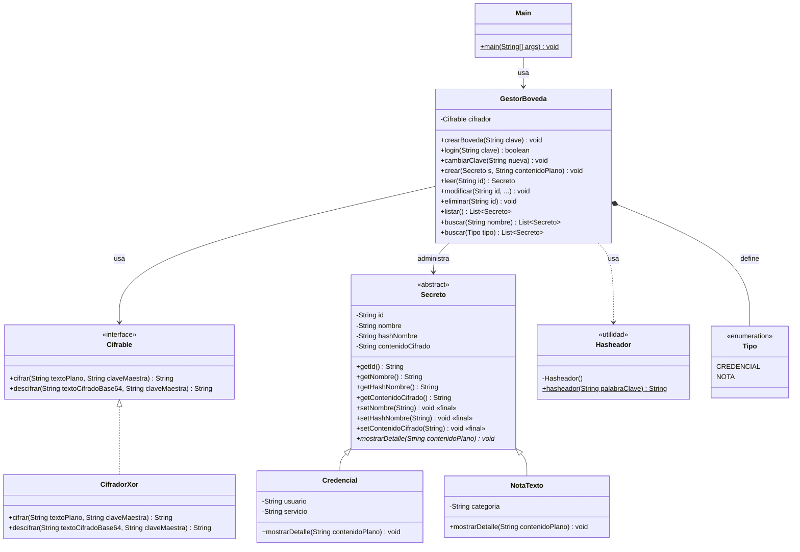

# Secure Vault

Proyecto final de Lenguajes y Paradigmas de Programación: baúl digital de secretos en consola (Java).

## Estructura

```
SECURE-VAULT/
├── vault/
│   ├── Secreto.java        (clase abstracta)
│   ├── Credencial.java
│   ├── NotaTexto.java
│   ├── Cifrable.java       (interfaz)
│   ├── CifradorXor.java
│   ├── Hasheador.java
│   ├── GestorBoveda.java
│   └── Main.java
└── vault_data/             (la crea la aplicación al ejecutarse)
```

## Requisitos

- JDK 17 o superior (`javac -version`)

## Compilación y ejecución

Desde la carpeta `SECURE-VAULT/`:

```
javac -encoding UTF-8 vault/*.java
java vault.Main
```

## Diagrama de clases

> Los métodos de `GestorBoveda` son una propuesta y siguen en discusión hasta que el equipo cierre las firmas.
> El código fuente del diagrama está en [`docs/diagrama-clases.mmd`](docs/diagrama-clases.mmd) y hay una versión en imagen en [`docs/diagrama-clases.png`](docs/diagrama-clases.png).


